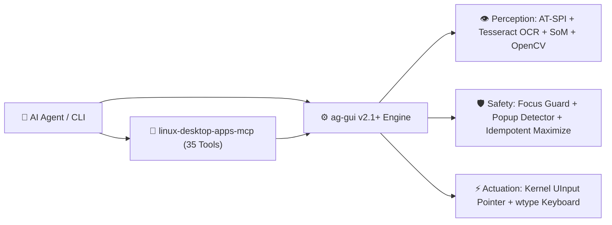
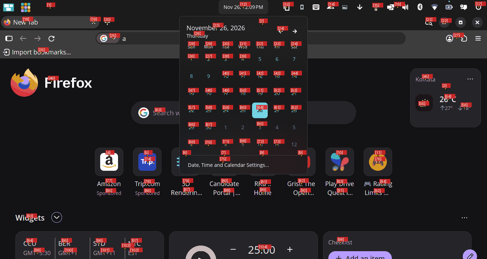
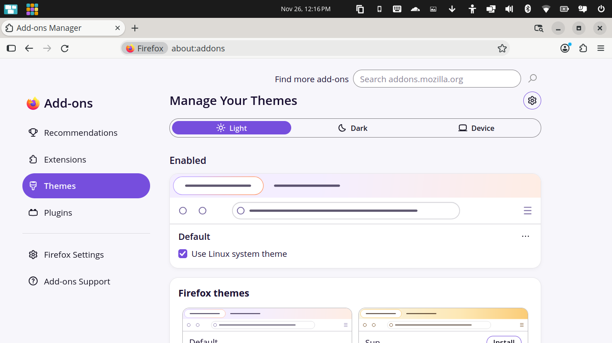

<div align="center">

# 🖱️ Antigravity COSMIC Desktop GUI Control

### Wayland-Native + Xwayland Desktop Automation Engine & 35-Tool FastMCP Server for Pop!_OS COSMIC

[](https://system76.com/cosmic)
[](https://www.python.org/)
[](bin/linux-desktop-apps-mcp)
[](bin/ag-gui)

*Control native Wayland apps (Firefox, Tuta Mail, COSMIC apps) and legacy Wine/Xwayland software (like Jagannatha Hora) purely via human-like mouse & keyboard actions — with zero X11 tool breakage.*

</div>

---

## ⚡ Why This Exists (X11 Tools vs. COSMIC Wayland Engine)

Traditional Linux automation tools (`xdotool`, `PyAutoGUI`, `scrot`) silently fail on **COSMIC Wayland**. This project replaces brittle hacks with a **kernel-level + compositor-aware stack**:

| Capability | Legacy X11 (`PyAutoGUI` / `xdotool`) | `ag-gui` v2.1+ (This Project) |
| :--- | :--- | :--- |
| **Wayland Mouse & Drag** | ❌ Blocked by Wayland isolation | ✅ **Kernel UInput** (`EV_ABS` + `EV_REL`) virtual tablet & wheel |
| **Wayland Keyboard & Hotkeys** | ❌ Fails on native Wayland windows | ✅ **`wtype`** with XKB alias normalization & stdin-safe typing |
| **Clean Screenshots** | ⚠️ Leaves temp files or fails on Wayland | ✅ **`cosmic-screenshot`** zero-`/tmp`-clutter capture |
| **UI Element Discovery** | ⚠️ Raw blind coordinate guessing | ✅ **AT-SPI + Dark-Mode OCR + Set-of-Mark (`[1] [2]`)** |
| **Textless Toolbar Icons** | ❌ Cannot click icons without labels | ✅ **OpenCV `TM_CCOEFF_NORMED`** multi-scale template matching |
| **Win32 / Wine Text Fields** | ❌ `Ctrl+A` concatenates & triggers errors | ✅ **Auto Win32 `replace_text`** (drag-select / `Home`+`Shift+End`) |
| **Runaway Typing Protection** | ❌ Types into wrong window on focus steal | ✅ **Focus Guard** + **X11/Wayland Popup Detector** |

---

## 🏗️ 3-Layer Hybrid Architecture



---

## 🖼️ Live Visual Demos

### 🎯 1. Set-of-Mark (SoM) Visual Tagger (`ag-gui som-inspect`)
Combines **AT-SPI** widgets and **Dark-Mode OCR** labels into collision-free numbered `[id]` badges with exact **yellow click-center dots** — eliminating coordinate guesswork:



### 🦊 2. Pure Mouse & Keyboard Browser Automation (Firefox Theme Switch)
Live end-to-end test on **Firefox (Wayland)**: launched, maximized, navigated to `about:addons` → `Themes`, and switched from **Device (Dark)** to **Light** using only mouse & keyboard controls:



---

## 🚀 Quick Start (CLI Examples)

### 1️⃣ Focus & Idempotently Maximize Any App
```bash
ag-gui focus firefox --maximize
```

### 2️⃣ Tag Every Interactive Element with Set-of-Mark & Click by ID
```bash
ag-gui som-inspect firefox
ag-gui click-mark 2
```

### 3️⃣ Locate & Click a Textless Icon with OpenCV
```bash
ag-gui find-icon /path/to/save_icon.png --window jhora
ag-gui click-icon /path/to/save_icon.png --window jhora
```

### 4️⃣ Single-Call Batch Macro with Focus Guard & Popup Detector
```bash
ag-gui batch '[
  {"action": "focus", "window": "jhora", "maximize": true},
  {"action": "click", "x": 310, "y": 240},
  {"action": "replace_text", "text": "1999", "x": 310, "y": 240}
]' --guard jhora --stop-on-popup
```

---

## 🧰 Complete Toolset

<details>
<summary><b>⚙️ CLI Subcommands (<code>ag-gui</code>) — Click to expand</b></summary>

- **Perception & Inspection:** `screenshot`, `screenshot-window`, `inspect-window`, `som-inspect`, `overlay-grid`, `find-elements`, `find-text`, `find-icon`, `focused`, `windows`, `display-info`
- **Mouse & Icon Actions:** `click`, `click-verify`, `click-element`, `click-text`, `click-mark`, `click-icon`, `drag`, `scroll`
- **Keyboard & Text:** `type`, `replace-text`, `key`, `hotkey`
- **Window & Macro Control:** `focus`, `maximize`, `wait-for-text`, `wait-for-change`, `copy-image`, `batch`

</details>

<details>
<summary><b>🔌 35 FastMCP Tools (<code>linux-desktop-apps-mcp</code>) — Click to expand</b></summary>

Includes `gui_batch`, `gui_som_inspect`, `gui_click_mark`, `gui_click_icon`, `gui_click_element`, `gui_click_text`, `gui_click_coords`, `gui_replace_text`, `gui_maximize_window`, `gui_focus_window`, `gui_find_elements`, `gui_find_text`, `gui_drag_and_drop`, `gui_scroll`, `gui_type`, `gui_hotkey`, `gui_wait_for`, `gui_take_screenshot`, `gui_inspect_window`, `gui_visual_grid_inspect`, `gui_copy_image_to_clipboard`, `gui_get_screen_size`, `gui_get_mouse_position`, `gui_get_display_info`, `launch_app`, `close_app`, `list_desktop_apps`, `list_running_windows`, `get_clipboard`, `set_clipboard`, `media_control`, `media_volume`, `system_volume`, `send_desktop_notification`, and `gui_smart_click`.

</details>

---

## 📁 Repository Structure

```text
antigravity-cosmic-desktop-gui-control/
├── SKILL.md                     # Antigravity skill guide, rules & workflow
├── bin/
│   ├── ag-gui                   # Core CLI automation engine (Python 3.12)
│   └── linux-desktop-apps-mcp   # 35-tool FastMCP server
├── mcp/                         # 35 JSON tool schemas for Antigravity MCP
├── scripts/
│   └── tuta_mailer.py           # Automated Tuta Mail Flatpak sender example
└── assets/
    ├── som-tagger-demo.png
    └── firefox-light-theme-demo.png
```

---

## 🛠️ System Requirements

- 🐧 **OS / Compositor:** Pop!_OS 24.04+ with COSMIC Wayland (`cosmic-comp`)
- 🐍 **Python 3.12+:** `evdev`, `Pillow`, `numpy`, `opencv-python`, `PyGObject` (`Atspi`)
- 🖥️ **System Binaries:** `wtype`, `tesseract-ocr`, `cosmic-screenshot`, `wmctrl`, `xdotool`, `wl-clipboard`
- 📦 **MCP Runner:** `uv` (runs `linux-desktop-apps-mcp` via `mcp<2`)
